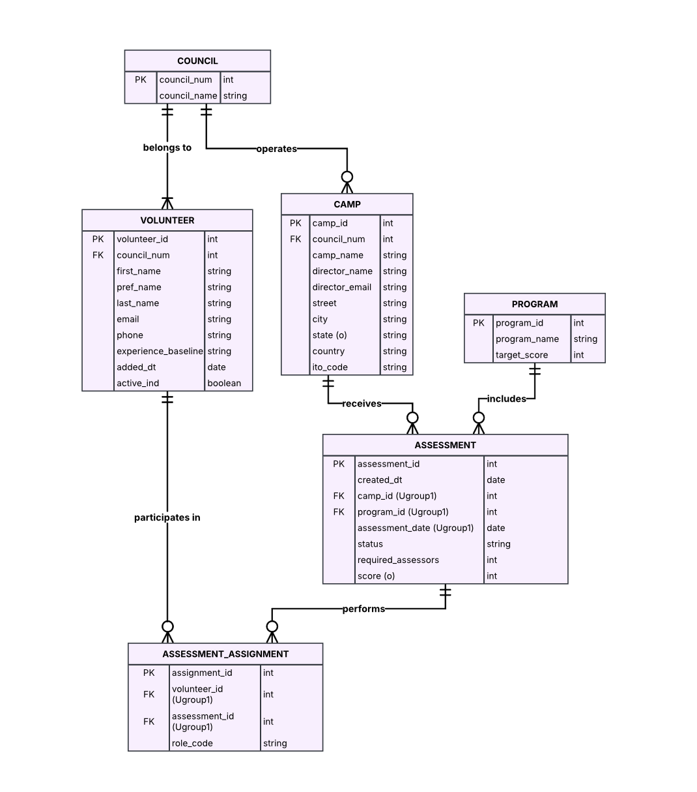

# README

## SCOUT ASSESSMENT SCHEDULER

---

### Configuration

> [!IMPORTANT]
> Before running application **create a `config.py`** file inside the `user-interface` sub-directory.

Populate database connection details as follows:

```python
DATABASE = {'user': '[enter user]',
            'password': '[enter pw]',
            'host': '[enter host]',
            'port': [enter port],
            'database': '[enter db name]'}
```

| Requirement | Details |
|---|---|
| **Database scripts** | Compatible with MySQL 8.0.16+. |
| **Python** | The program was developed using **Python 3.12.2**, but will run on Python versions >= 3.10. |
| **Libraries** | All additional Python library requirements can be found in a **`requirements.txt`** file. |

To **run** the CLI-program, navigate to the `user-interface` sub-directory then execute:

```bash
python main.py
```

---

### Relational Model



#### Note on Constraints and Business Logic (implementation method in parentheses)

<details open>
<summary><b>Volunteer Entity</b></summary>

| # | Constraint / Business Logic | Implementation |
|:-:|---|---|
| 1 | experience_baseline field values (`'EXPERIENCED'`, `'NEW'`); allow volunteers to be added under assumption of having experience | DDL |
| 2 | Prevent deactivation if assigned to pending assessment(s) | Python |

</details>

<details open>
<summary><b>Camp Entity</b></summary>

| # | Constraint / Business Logic | Implementation |
|:-:|---|---|
| 1 | country field defaults to `'United States'` | DDL |
| 2 | state field must be populated if country is `'United States'`; null otherwise | DDL / Python |

</details>

<details open>
<summary><b>Program Entity</b></summary>

| # | Constraint / Business Logic | Implementation |
|:-:|---|---|
| 1 | target_score value must be greater than 0 | DDL |

</details>

<details open>
<summary><b>Assessment</b></summary>

| # | Constraint / Business Logic | Implementation |
|:-:|---|---|
| 1 | Unique on (camp_id, program_id, assessment_year); assessment_year is stored field derived from assessment_dt | DDL |
| 2 | status field values (`'PLANNED'`, `'FILLED'`, `'COMPLETED'`) | |
| 3 | score cannot be populated until assessment status is `'COMPLETED'` | DDL / Python |
| 4 | assessment_dt must be in the future (DDL); updating date has same constraint (Python) | DDL / Python |
| 5 | required_assessors value must be greater than 0 | DDL |
| 6 | Completed assessments cannot be updated | Python |
| 7 | Set status field to `'FILLED'` whenever number of assignments matches required_assessors; status reverts on reduction in assignments | DDL - Procedure/Trigger |
| 8 | score value must be greater than or equal to 0 and cannot exceed program's target_score value | DDL - Trigger |
| 9 | assessment_dt cannot be updated to a date which causes volunteer scheduling conflict | DDL - Trigger |
| 10 | Assessments in `'COMPLETED'` status cannot be deleted | Python |
| 11 | Prohibit required_assessors from being updated to a value smaller than existing number of assignments | DDL - Trigger |
| 12 | Prohibit update to `'COMPLETED'` status when no lead is assigned | DDL - Trigger |

</details>

<details open>
<summary><b>Assessment Assignment Entity</b></summary>

| # | Constraint / Business Logic | Implementation |
|:-:|---|---|
| 1 | role_code field values (`'LEAD'`, `'ASSESSOR'`, `'ALTERNATE'`) | DDL |
| 2 | role_code cannot be `'LEAD'` unless experienced; experienced defined as volunteer having `'EXPERIENCED'` as experience_baseline or having been assigned to an assessment with `'COMPLETED'` status | DDL - Views, Trigger / Python |
| 3 | Number of assigned volunteers cannot exceed required_assessors for an assessment | DDL - Trigger |
| 4 | Only one role_code can be assigned as `'LEAD'` per assessment | DDL |
| 5 | A volunteer can only be assigned once to a single assessment | DDL |
| 6 | Volunteer must be active to be assigned | DDL - Trigger / Python |
| 7 | Not more than half of the required_assessors value can be inexperienced (complement of experienced definition above) | DDL - Views, Python |
| 8 | A volunteer cannot be assigned as role_code `'LEAD'` if they led the last three consecutive assessments for a unique (camp, program) combination | DDL - Trigger |
| 10 | No additional volunteers can be assigned if there are already the number of required assessors; Any assignment beyond required_assessors value must have role_code `'ALTERNATE'`; Can't assign volunteers with role_code `'ALTERNATE'` until required_assessors is met | DDL - Trigger / Python |

</details>

---

### User Flow Chart

> [!NOTE]
> TODO

---

### Lessons Learned

> [!NOTE]
> TODO: needs refinement

1. Strategizing optimal placements for user-defined constraints and logic
2. Exposure to Procedures and Triggers to implement nuanced inter-table dependencies
3. Learned strategies for establishing MySQL database connections with Python (in addition to executing DML commands)
4. Realized the benefit of upfront diagramming and documentation of business requirements (something that seems simple can quickly become complex)

There were many possible design implementations for user-defined logic. Made trade-offs with respect to relaxing some logical constraints in the database, while enforcing through the user facing application.

Future use by Scouting America admin volunteers. Users will begin interacting with the CLI tool which should generate feedback regarding the user experience. This feedback can be documented for future teams to apply in subsequent updates. With feedback from the CLI, a web app can be more efficiently designed for optimal user experience. One possible area for added functionality is tracking more granular information about the assessments. Similarly, the application could be expanded to generate automated notices to volunteers regarding scheduling (changes) and outstanding needs. The insights could also be used to track and improve volunteer engagement.
